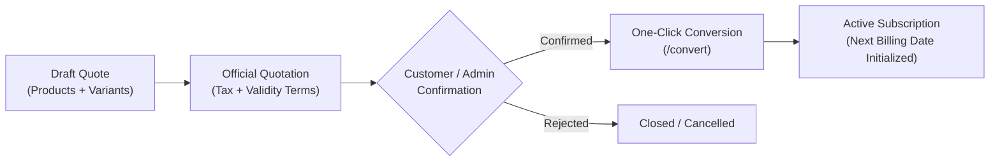
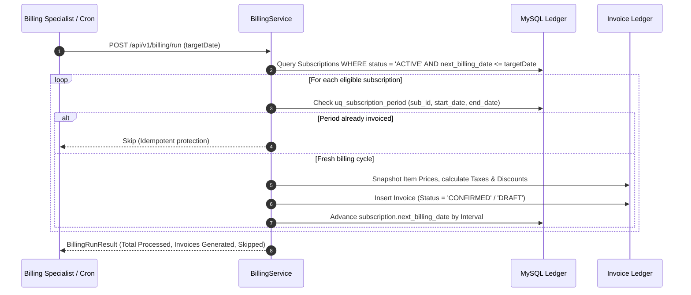
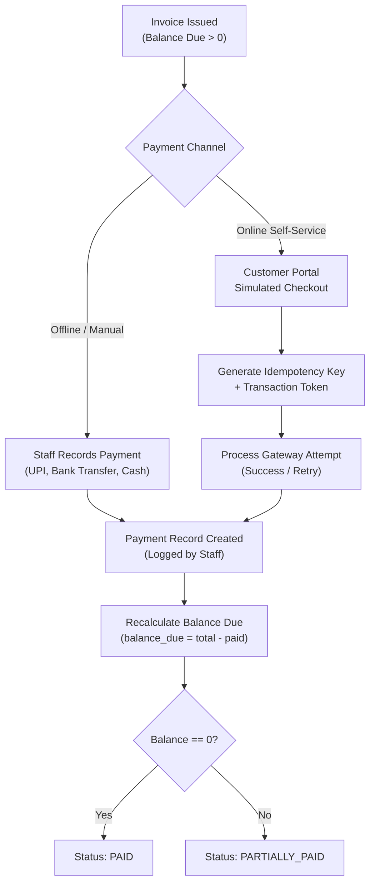
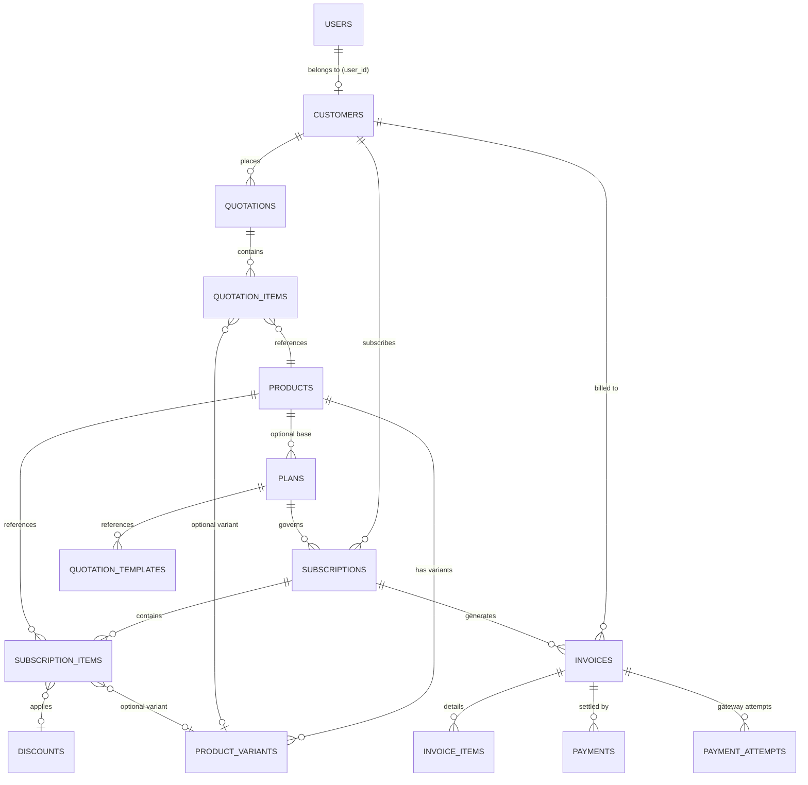

# Beacon — B2B Subscription & Recurring Billing Engine

[](https://openjdk.org/)
[](https://spring.io/projects/spring-boot)
[](https://react.dev/)
[](https://www.typescriptlang.org/)
[](https://vitejs.dev/)
[](https://tailwindcss.com/)
[](https://www.mysql.com/)
[](./AGENTS.md)

---

## 1. Executive Summary

**Beacon** (by BrightLoop) is an enterprise-grade, self-hosted B2B SaaS subscription lifecycle and recurring billing management platform. Built to eliminate recurring billing overhead and vendor lock-in from third-party BaaS providers (e.g., Stripe Billing, Chargebee, Recurly), Beacon delivers:

- **End-to-End Subscription Lifecycle**: Quotes → Approvals → Contract Activation → Automated Billing Runs → Dynamic Invoicing → Multi-channel Settlement.
- **Dynamic Pricing & Variant Logic**: Multi-tier software tiers, recurring add-ons, implementation services, and runtime variant price adjustments (e.g., ERP branding surcharges).
- **Automated Recurring Billing Engine**: Scheduled and on-demand batch runs with unique period constraints, immutable price snapshotting, and strict zero-duplicate invoice guarantees.
- **Complete In-House Payment Processing**: Manual offline payment logging (Bank Transfer, UPI, Cash) alongside an idempotent, cryptographically safe simulated payment gateway.
- **Real-Time Financial Intelligence**: Executive KPI cards, MRR & ARR tracking, receivables aging analysis (Current, 1-30, 31-60, 90+ days), and live system audit trails.
- **Zero Third-Party Cloud BaaS**: Runs entirely on your infrastructure with native Spring Boot 4, React 19, and local MySQL.

---

## 2. High-Level Architecture

Beacon is architected around a decoupled client-server architecture with transactional database guarantees:

```
┌────────────────────────────────────────────────────────────────────────┐
│                        Vite + React 19 Frontend                        │
│   (Tailwind CSS v4, Lucide Icons, Recharts, Axios with JWT Interceptor) │
└───────────────────┬────────────────────────────────┬───────────────────┘
                    │ REST API Calls                 │ REST API Calls
                    │ (Bearer Token Auth)            │ (Bearer Token Auth)
                    ▼                                ▼
┌──────────────────────────────────────┐  ┌──────────────────────────────┐
│       Admin & Staff Operations       │  │    Customer Self-Service     │
│   - Catalogue, Variants & Plans      │  │    - Active Subscriptions    │
│   - Quotation-to-Contract Engine     │  │    - Invoice History & PDFs  │
│   - Billing Runs & Tax Management    │  │    - Simulated Card Checkout │
│   - Financial Analytics & Aging      │  └──────────────┬───────────────┘
└───────────────────┬──────────────────┘                 │
                    │                                    │
                    ▼                                    ▼
┌────────────────────────────────────────────────────────────────────────┐
│                      Spring Boot 4.x REST Backend                      │
│   (Java 17, Spring Data JPA, Hibernate Dialect, Spring Security, JJWT) │
├────────────────────────────────────────────────────────────────────────┤
│  Modules:                                                              │
│  ├─ com.brightloop.auth         (JWT issuance, BCrypt, RBAC)          │
│  ├─ com.brightloop.catalogue    (Products, Variants, Plans)            │
│  ├─ com.brightloop.subscriptions (Quotes, Conversion, Subscriptions)   │
│  ├─ com.brightloop.billing      (Automated Billing Engine & Periods)   │
│  ├─ com.brightloop.invoices     (Invoice Ledger & Snapshots)           │
│  ├─ com.brightloop.payments     (Idempotent Gateway & Manual Logging)  │
│  ├─ com.brightloop.taxes        (Tax Rates & Surcharges)               │
│  ├─ com.brightloop.discounts    (Fixed/Percentage Promotional Rules)   │
│  └─ com.brightloop.analytics    (KPI Aggregations & Receivables Aging) │
└───────────────────────────────────┬────────────────────────────────────┘
                                    │ JDBC / JPA Connection Pool
                                    ▼
┌────────────────────────────────────────────────────────────────────────┐
│                       Local MySQL (brightloop_db)                      │
│   - Strict Foreign Key Cascades & Constraints                          │
│   - Composite Unique Constraints (preventing duplicate billing periods)│
│   - Indexed on (status, next_billing_date) & (status, due_date)        │
└────────────────────────────────────────────────────────────────────────┘
```

---

## 3. Core Business Workflows

### 3.1 Quotation-to-Subscription Pipeline

Beacon enforces a structured sales-to-activation cycle:



1. **Quotation Drafting**: Line items are configured with base products, variant adjustments, applicable discounts, and tax percentages.
2. **Review & Validity**: Quotation templates define standardized terms (e.g., Net 15, Net 30, 30-day price locks).
3. **Automated Conversion**: When approved, `POST /api/v1/quotations/{id}/convert` creates an `ACTIVE` subscription and sets the first billing window without manual data re-entry.

### 3.2 Recurring Billing Engine & Invoicing



- **Price Snapshotting**: Invoices capture prices at the time of generation. Catalog changes never mutate historical invoices.
- **Double-Billing Prevention**: Database composite unique key `uq_subscription_period (subscription_id, billing_period_start, billing_period_end)` guarantees idempotent billing runs.

### 3.3 Payment Reconciliation & Simulated Gateway



---

## 4. Technology Stack & Design Decisions

| Layer | Technology | Key Capabilities & Rationale |
| :--- | :--- | :--- |
| **Backend Framework** | **Spring Boot 4.1.2** (Java 17) | Modern enterprise framework with low memory footprint and high throughput. |
| **Persistence / ORM** | **Spring Data JPA / Hibernate** | Type-safe entity mappings, relational cascades, declarative transactions (`@Transactional`). |
| **Security & Auth** | **Spring Security + JJWT 0.12.6** | Stateless token-based security, BCrypt password hashing (cost factor 10), and RBAC route gating. |
| **Database** | **MySQL 8.0+ / MariaDB** | Full ACID transactions, strict relational foreign keys, UTC timestamps, and UTF-8 collation (`utf8mb4`). |
| **Frontend Framework**| **React 19.3 + TypeScript** | React 19 Concurrent features, strict static typing, and modular component isolation. |
| **Build & Tooling** | **Vite 8.3 + Oxlint** | Sub-second cold starts, instant Hot Module Replacement (HMR), and high-performance Rust-based linting. |
| **Design System** | **Tailwind CSS v4** | Clean B2B SaaS palette (Deep Navy `#0F172A`, Royal Blue `#1E3A8A`, Slate `#F8FAFC`), Inter typography. |
| **Data Visualization**| **Recharts 3.10** | Responsive SVG charts for MRR growth, invoice status breakdowns, and aging buckets. |

---

## 5. Domain Model & Database Schema

The persistence layer is modeled under strict Third Normal Form (3NF) with explicit referential constraints:



### Key Entities & Rules

- **`users`**: Role-based credentials (`ADMIN`, `STAFF`, `CUSTOMER`), BCrypt hashes, active status toggling.
- **`customers`**: Multi-tenant customer profiles linking company data, addresses, and optional associated self-service user accounts.
- **`products` & `product_variants`**: Differentiates core software licenses, optional recurring add-ons, and one-time implementation services with dynamic price adjustments.
- **`plans`**: Dictates billing cadence (`DAILY`, `WEEKLY`, `MONTHLY`, `YEARLY`), minimum seat commitment, pause policies, and auto-expiration dates.
- **`subscriptions` & `subscription_items`**: Live contracts tracking billing intervals, status transitions (`ACTIVE`, `PAUSED`, `CLOSED`), and future billing schedules.
- **`invoices` & `invoice_items`**: Immutable financial ledger capturing line-item descriptions, tax percentages, discount amounts, and payments applied.
- **`payments` & `payment_attempts`**: Immutable transaction log preserving audit trails, payment methods (`UPI`, `BANK_TRANSFER`, `CASH`, `CREDIT_CARD`, `SIMULATED_GATEWAY`), and gateway idempotency keys.

---

## 6. REST API Reference

All endpoints are hosted at `/api/v1` and return standardized JSON responses.

### 6.1 Authentication (`/api/v1/auth`)
| Method | Endpoint | Access | Description |
| :--- | :--- | :--- | :--- |
| `POST` | `/auth/login` | Public | Authenticates credentials and returns JWT token + user details. |
| `POST` | `/auth/register` | Public | Customer self-registration. |
| `POST` | `/auth/staff` | `ADMIN` | Provisions internal staff accounts. |

### 6.2 Products & Catalogue (`/api/v1/products`, `/api/v1/plans`)
| Method | Endpoint | Access | Description |
| :--- | :--- | :--- | :--- |
| `GET` | `/products` | Authenticated | List all products with their associated variants. |
| `POST` | `/products` | `ADMIN`, `STAFF` | Create a new catalogue item (`SOFTWARE`, `ADDON`, `SERVICE`). |
| `PUT` | `/products/{id}` | `ADMIN` | Update product details and base pricing. |
| `DELETE`| `/products/{id}` | `ADMIN` | Deactivate/remove a product. |
| `GET` | `/products/{id}/effective-price` | Authenticated | Calculate effective unit price with variant adjustments. |
| `POST` | `/products/{id}/variants` | `ADMIN` | Append a variant with price differential. |
| `GET` | `/plans` | Authenticated | Retrieve available subscription plans. |
| `POST` | `/plans` | `ADMIN` | Create a plan with specific billing interval & constraints. |

### 6.3 Quotations & Subscriptions (`/api/v1/quotations`, `/api/v1/subscriptions`)
| Method | Endpoint | Access | Description |
| :--- | :--- | :--- | :--- |
| `GET` | `/quotations` | `ADMIN`, `STAFF` | List all quotations with customer & item details. |
| `POST` | `/quotations` | `ADMIN`, `STAFF` | Draft a new customer quote. |
| `PUT` | `/quotations/{id}/status` | `ADMIN`, `STAFF` | Transition quote status (`DRAFT`, `QUOTATION`, `CONFIRMED`). |
| `POST` | `/quotations/{id}/convert` | `ADMIN`, `STAFF` | **Converts confirmed quote into an active subscription.** |
| `GET` | `/subscriptions` | Authenticated | Fetch active/paused subscriptions (filtered by role). |
| `POST` | `/subscriptions/{id}/pause` | `ADMIN`, `STAFF` | Temporarily halt recurring billing for a subscription. |
| `POST` | `/subscriptions/{id}/resume` | `ADMIN`, `STAFF` | Reactivate paused subscription and recalculate billing date. |
| `POST` | `/subscriptions/{id}/close` | `ADMIN`, `STAFF` | Terminate subscription contract. |
| `POST` | `/subscriptions/{id}/renew` | `ADMIN`, `STAFF` | Extend subscription expiration period. |

### 6.4 Billing & Invoicing (`/api/v1/billing`, `/api/v1/invoices`)
| Method | Endpoint | Access | Description |
| :--- | :--- | :--- | :--- |
| `POST` | `/billing/run` | `ADMIN`, `STAFF` | Execute batch billing for all subscriptions due on or before target date. |
| `GET` | `/invoices` | Authenticated | List invoices with status, total amounts, and balances. |
| `GET` | `/invoices/{id}` | Authenticated | Get full invoice breakdown with line items and payments. |
| `POST` | `/invoices/{id}/confirm` | `ADMIN`, `STAFF` | Move draft invoice to `CONFIRMED` status. |
| `POST` | `/invoices/{id}/cancel` | `ADMIN` | Void/cancel an unpaid invoice. |

### 6.5 Payments & Gateway (`/api/v1/payments`, `/api/v1/gateway`)
| Method | Endpoint | Access | Description |
| :--- | :--- | :--- | :--- |
| `GET` | `/payments` | `ADMIN`, `STAFF` | Review all logged transactions and payment methods. |
| `POST` | `/payments/manual` | `ADMIN`, `STAFF` | Log offline settlement (Cash, Bank Transfer, UPI). |
| `POST` | `/gateway/checkout` | Authenticated | Initialize an idempotent simulated checkout session. |
| `POST` | `/gateway/confirm` | Authenticated | Finalize gateway transaction and settle invoice balance. |

### 6.6 Taxes & Discounts (`/api/v1/taxes`, `/api/v1/discounts`)
| Method | Endpoint | Access | Description |
| :--- | :--- | :--- | :--- |
| `GET` | `/taxes` | Authenticated | Retrieve registered tax slabs (e.g., 18% GST). |
| `POST` | `/taxes` | `ADMIN` | Configure new regional tax rates. |
| `GET` | `/discounts` | `ADMIN`, `STAFF` | List active promotional codes. |
| `POST` | `/discounts/validate` | Authenticated | Validate promo code eligibility against purchase threshold. |

### 6.7 Analytics & Financial Intelligence (`/api/v1/analytics`)
| Method | Endpoint | Access | Description |
| :--- | :--- | :--- | :--- |
| `GET` | `/analytics/kpi` | `ADMIN`, `STAFF` | Summary metrics: Active Subscriptions, MRR, Overdue counts. |
| `GET` | `/analytics/revenue-trend` | `ADMIN`, `STAFF` | Historical monthly revenue time-series. |
| `GET` | `/analytics/status-distribution`| `ADMIN`, `STAFF` | Subscription & invoice status distribution counts. |
| `GET` | `/analytics/receivables-aging` | `ADMIN`, `STAFF` | Aging buckets (Current, 1-30, 31-60, 61-90, 90+ days). |
| `POST` | `/analytics/seed-demo-data` | `ADMIN` | Populate rich demo scenarios for testing. |

---

## 7. Getting Started

### 7.1 Prerequisites
- **Java**: OpenJDK 17 or higher
- **Maven**: 3.9+ (or use the bundled `./mvnw` wrapper)
- **Node.js**: v18+ or v20+ with `npm`
- **Database**: MySQL Server 8.0+ or MariaDB (e.g., via XAMPP) running locally on port `3306`

---

### 7.2 Database Setup

1. Start your local MySQL service (e.g., via XAMPP Control Panel).
2. Create the target database:
   ```sql
   CREATE DATABASE IF NOT EXISTS brightloop_db CHARACTER SET utf8mb4 COLLATE utf8mb4_unicode_ci;
   ```
3. Load the schema and master seed dataset:
   ```bash
   # From the project root
   mysql -u root -p brightloop_db < backend/src/main/resources/schema.sql
   mysql -u root -p brightloop_db < seed.sql
   ```

---

### 7.3 Backend Setup

1. Navigate to the `backend/` directory:
   ```bash
   cd backend
   ```
2. Verify configuration in `src/main/resources/application.properties`:
   ```properties
   server.port=8080
   spring.datasource.url=jdbc:mysql://localhost:3306/brightloop_db?createDatabaseIfNotExist=true&useSSL=false&allowPublicKeyRetrieval=true
   spring.datasource.username=root
   spring.datasource.password=
   ```
   *(Set `DB_PASSWORD` as an environment variable or edit the property directly if your MySQL root account has a password).*

3. Build and launch the Spring Boot application:
   ```bash
   # Using Maven wrapper (Windows)
   .\mvnw.cmd spring-boot:run

   # Or using Maven wrapper (Linux/macOS)
   ./mvnw spring-boot:run
   ```
4. Confirm health check:
   ```bash
   curl http://localhost:8080/api/v1/health
   # Expected response: {"status":"UP","database":"MySQL Active", ...}
   ```

---

### 7.4 Frontend Setup

1. Open a new terminal and navigate to `frontend/`:
   ```bash
   cd frontend
   ```
2. Install dependencies:
   ```bash
   npm install
   ```
3. Start the Vite development server:
   ```bash
   npm run dev
   ```
4. Access the web console at: **`http://localhost:5173`**

---

### 7.5 Pre-Seeded Default Accounts

The master seed script initializes the following accounts out of the box:

| Email | Default Password | Role | Access Level |
| :--- | :--- | :--- | :--- |
| **`admin@brightloop.com`** | `Compliant@Pass123` *(or `Admin123!`)* | `ADMIN` | Full Platform & Rules Access |
| **`staff@brightloop.com`** | `Compliant@Pass123` | `STAFF` | Billing, Operations & Invoices |
| **`customer@acme.com`** | `Compliant@Pass123` | `CUSTOMER` | Customer Self-Service Portal |
| **`alice@retailcorp.com`** | `Compliant@Pass123` | `CUSTOMER` | Customer Self-Service Portal |

---

## 8. Directory Structure

```
E:\Beacon
├── backend/                               # Spring Boot 4 REST Backend
│   ├── src/
│   │   ├── main/
│   │   │   ├── java/com/brightloop/
│   │   │   │   ├── BeaconApplication.java # Spring Boot Entrypoint
│   │   │   │   ├── analytics/             # KPI computations & Aging Receivables
│   │   │   │   ├── auth/                  # Authentication, JWT, and User signup
│   │   │   │   ├── billing/               # Batch Billing Engine & Scheduler
│   │   │   │   ├── catalogue/             # Products, Variants, and Plans
│   │   │   │   ├── common/                # Health checks & shared controllers
│   │   │   │   ├── config/                # Spring Security & CORS configuration
│   │   │   │   ├── customers/             # Customer directory & User linking
│   │   │   │   ├── discounts/             # Promo codes & validation logic
│   │   │   │   ├── invoices/              # Invoices & Invoice Item line totals
│   │   │   │   ├── payments/              # Payment gateway & manual settlements
│   │   │   │   ├── subscriptions/         # Quotations & Subscription lifecycles
│   │   │   │   ├── taxes/                 # Regional tax configuration
│   │   │   │   └── users/                 # RBAC management & password reset
│   │   │   └── resources/
│   │   │       ├── application.properties # Server, MySQL & JWT configuration
│   │   │       ├── schema.sql             # Full DDL schema
│   │   │       └── seed.sql               # Initial master data
│   │   └── test/                          # Unit and integration tests
│   ├── mvnw & mvnw.cmd                    # Maven wrappers
│   └── pom.xml                            # Backend dependencies & build plugins
│
├── frontend/                              # React 19 + TypeScript + Vite Frontend
│   ├── src/
│   │   ├── assets/                        # Static brand assets
│   │   ├── components/ui/                 # Atomic UI system (Buttons, Cards, Modals, Tables)
│   │   ├── context/                       # AuthContext & Session management
│   │   ├── features/
│   │   │   ├── analytics/                 # Finance Dashboard & Recharts visualizations
│   │   │   ├── auth/                      # Login, Register, Password Validation
│   │   │   ├── billing/                   # Invoices, Payments, Tax & Discount Tabs
│   │   │   ├── catalogue/                 # Catalogue, Quotations, Subscriptions & Customers
│   │   │   └── portal/                    # Customer self-service portal
│   │   ├── layout/                        # AppShell, Navbar, Sidebar & Protected Routes
│   │   ├── lib/                           # Formatting helpers & Tailwind utilities
│   │   ├── services/api.ts                # Axios instance with JWT interceptors
│   │   ├── types/                         # Global TypeScript domain interfaces
│   │   ├── App.tsx                        # Client-side router configuration
│   │   └── main.tsx                       # React root entrypoint
│   ├── package.json                       # Frontend dependencies & scripts
│   ├── tailwind.config / vite.config.ts   # Build configuration
│   └── tsconfig.json                      # Strict TypeScript compiler options
│
├── AGENTS.md                              # Team operational rules & architecture boundaries
├── seed.sql                               # Root master database seed script
└── README.md                              # Technical system documentation
```

---

## 9. Security, Reliability & Compliance

- **Authentication & RBAC**: Every request to protected API routes validates an `Authorization: Bearer <JWT>` header. The token expiration is set to 24 hours with cryptographic signature validation.
- **Password Hygiene**: Password hashes utilize the industry-standard BCrypt adaptive hashing function. Frontend password validators enforce uppercase, lowercase, numeric, special character, and minimum length policies.
- **Idempotent Billing Runs**: Scheduled billing operations are safeguarded by database unique constraints to prevent duplicate billing runs even under concurrent triggers.
- **Gateway Idempotency**: Checkout requests require unique idempotency keys to avoid double-charging cards or double-logging settlements during network retries.
- **Price Integrity**: Line-item unit prices are copied onto the invoice record upon generation, ensuring that future price updates to a catalog product do not retroactively modify past billing statements.

---

## 10. Development Team & Division of Responsibilities

Built with strict domain isolation to eliminate merge conflicts:

| Team Member | Branch | Backend Responsibility | Frontend Responsibility |
| :--- | :--- | :--- | :--- |
| **Johan** | `feature/johan-core-subs` | Auth, Product Catalogue, Subscription & Quotation Engine | Catalogue, Quotations, Customer Directory, Subscriptions |
| **Elsa** | `feature/elsa-billing-payments`| Billing Engine, Invoices, Taxes, Discounts, Payments & Gateway | Invoice Management, Payment Processing, Billing Rules |
| **Goutham** | `feature/goutham-ui-portal` | Financial Analytics & Aggregations | Design System, UI Components, AppShell, Executive Dashboard, Customer Portal |

---

## 11. Verification & Testing

### Running Backend Unit & Integration Tests
```bash
cd backend
.\mvnw.cmd test
```

### Running Frontend Type-Checking & Linting
```bash
cd frontend
npm run build   # TypeScript typecheck & production build
npm run lint    # Oxlint high-performance code inspection
```

---

© 2026 BrightLoop. All rights reserved. Self-hosted, cloud-agnostic subscription management.
